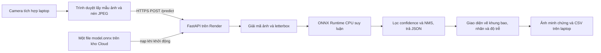

# Lab 3: camera laptop, nhận dạng ba trạng thái khẩu trang và Cloud

Ngày kiểm tra nguồn: **09/10/2026**. Đường dẫn dự án: `D:\STUDY\NAM_4_2026-2027\HK1\IoT\lab3`.

## Bắt đầu ngay

1. Đọc mục 1 để thống nhất cách hiểu đề.
2. Mở `evidence/data-review.html` để rà soát các cặp ảnh giống nhau và nhãn đeo sai. Dataset đã tải, chuyển nhãn và chia tập tại `data/yolo`.
3. Cài môi trường ở bước 4.1; chạy `python pack_data.py`; mở `TRAIN_COLAB.ipynb` trong Colab để huấn luyện.
4. Lấy `assets/model.onnx` sau huấn luyện, chạy API local, rồi triển khai Render.
5. Mở giao diện, dùng camera laptop và lưu CSV/ảnh minh chứng.

**Trạng thái hiện tại:** đã đọc toàn bộ 4 slide, kiểm tra dataset thật, chuẩn bị dữ liệu, viết mã và kiểm thử phần mềm. Chưa huấn luyện mô hình khẩu trang, chưa truy cập camera của bạn và chưa triển khai Cloud. Không có accuracy, mAP hay độ trễ demo đã đo để báo cáo. Smoke test dùng mô hình ngẫu nhiên riêng để xác minh định dạng xuất; mô hình này không thuộc bộ model nộp/demo.

## 1. Yêu cầu lab và phương án đề xuất

### Nội dung đề, theo từng slide

Nguồn: file PowerPoint bạn cung cấp, `3- Phat trien he thong IoT LAB 3-2.pptx`, tại thư mục `IoT\tài liệu\slide`.

**Slide 1, yêu cầu chung:**

- Dataset từ Lab 2 hoặc một dataset khác.
- Huấn luyện bằng một mô hình học sâu nhẹ.
- Xuất mô hình ra **một file**, lưu trên Cloud.
- Thu nhận ảnh từ **camera thường hoặc camera IoT**.
- Nhận dạng cùng lúc ba loại nhãn khác nhau.
- Viết giao diện hiển thị kết quả.
- Đo thời gian suy luận trên Cloud, phản hồi local–Cloud và độ trễ toàn trình.

**Slide 2, phần hỗ trợ/ví dụ:**

- Đề ghi “Cung cấp API”, nhưng file không chứa URL, tài liệu request/response hoặc thông tin xác thực.
- Teachable Machine xuất hiện sau `e.g.`: đây là **ví dụ công cụ huấn luyện**, không phải công cụ bắt buộc.
- Ví dụ face mask có ba nhãn: đeo, không đeo và đeo chưa đúng; ghi **mỗi nhãn 20 mẫu khác nhau**.
- Ví dụ nhắc xuất một file và backend “mạch Arduino”, với `Load model()` rồi `prediction` trên từng mẫu.
- Có lựa chọn dataset hình ảnh khác. Vì vậy face mask là phương án minh họa được đề hỗ trợ; ta chủ động chọn nó theo mong muốn của bạn.

**Slide 3:** hai tài liệu tham khảo: [repo chandrikadeb7](https://github.com/chandrikadeb7/Face-Mask-Detection) và [dataset andrewmvd trên Kaggle](https://www.kaggle.com/datasets/andrewmvd/face-mask-detection).

**Slide 4:** hình “Thank you”; không có yêu cầu bổ sung. File không có speaker notes chứa yêu cầu khác.

**Sản phẩm nên nộp:** mã nguồn, một file mô hình triển khai, địa chỉ API Cloud, giao diện camera, thông tin dataset/chia tập, đánh giá mô hình, CSV thống kê độ trễ và minh chứng demo. Danh sách hồ sơ nộp và định dạng báo cáo là đề xuất của hướng dẫn; slide chưa quy định chi tiết.

### “Cùng lúc ba nhãn” có hai cách hiểu

1. **Phân loại ảnh:** một ảnh/khuôn mặt được gán một trong ba trạng thái. Output ba điểm số rồi chọn nhãn cao nhất. Hiển thị ba điểm số không chứng minh phát hiện ba người thuộc ba nhãn trong một khung hình.
2. **Phát hiện đối tượng:** cùng một khung hình có nhiều khuôn mặt; mỗi khuôn mặt có khung bao, một nhãn và confidence. Có thể hiển thị đủ ba trạng thái cùng lúc.

Slide 1 nghiêng về cách hiểu 2, còn ví dụ đưa từng mẫu vào `prediction` ở slide 2 phù hợp cách hiểu 1. Đề chưa định nghĩa output đủ rõ để kết luận tuyệt đối.

**Giả định triển khai:** chọn cách hiểu 2 để đáp ứng trường hợp chặt hơn. Dùng **YOLO11n detect**, fine-tune trên ba lớp, xuất ONNX. Không dùng `yolo11n-cls.pt`, vì đó là mô hình classification. YOLO11n là biến thể nhỏ trong họ YOLO11; số tham số bản COCO được nhà phát triển công bố khoảng 2,6 triệu. Số tham số và hiệu năng thực tế phụ thuộc đầu ra ba lớp và cấu hình. [Tài liệu YOLO11](https://docs.ultralytics.com/models/yolo11)

**Teachable Machine:** Image Project huấn luyện phân loại ảnh, không tự tạo detector với nhiều bounding box. Vì vậy không chọn làm công cụ chính cho phương án này. Nếu giảng viên xác nhận chỉ cần một người một nhãn, TM là lựa chọn dễ hơn. Muốn ghép detector khuôn mặt với classifier TM phải thêm một mô hình và kiểm tra các crop; phức tạp hơn và làm yêu cầu một file khó giải thích. [Thư viện chính thức TM Image](https://github.com/googlecreativelab/teachablemachine-community/tree/master/libraries/image)

### Camera laptop và điểm cần xác nhận

Camera tích hợp là camera thường. Trình duyệt trên laptop lấy ảnh, kết nối Internet gửi ảnh lên API Cloud, nhận kết quả về giao diện. Laptop đóng vai trò thiết bị thu nhận và client của hệ thống kết nối Cloud. Không cần mua camera hay Arduino để thực hiện luồng này.

Hai nội dung cần xác nhận với giảng viên, nhưng không cản trở việc chuẩn bị mã/dataset:

- Ví dụ ghi “backend (mạch Arduino)” có bắt buộc phần cứng riêng khi chấm bài không? Nếu bắt buộc, phương án laptop hiện tại chưa đáp ứng tiêu chí đó.
- “Cùng lúc” có bắt buộc ba trạng thái xuất hiện trong cùng một khung hình không? Phương án detector hỗ trợ, nhưng cần cảnh demo có đủ ba trạng thái.

Không được viết trong báo cáo rằng giảng viên đã đồng ý thay Arduino khi chưa có xác nhận. Hướng dẫn ưu tiên điều kiện không mua phần cứng của bạn và ghi rõ giả định này.

## 2. Dataset phù hợp hoặc phương án tự thu thập

### Dataset 1: Face Mask Detection của andrewmvd, lựa chọn chính

[Trang gốc Kaggle](https://www.kaggle.com/datasets/andrewmvd/face-mask-detection). Chính là liên kết trong slide 3. Metadata Kaggle ghi tác giả hiển thị Larxel, CC0: Public Domain.

Đã tải **416.968.083 bytes**, mở toàn bộ ZIP và đọc tất cả XML, không chỉ dựa vào tên dataset:

- 853 ảnh PNG và 853 XML Pascal VOC.
- Ba tên nhãn thật: `with_mask`, `without_mask`, `mask_weared_incorrect`.
- Số **khuôn mặt có nhãn**, không phải số ảnh: 3.232 đeo đúng, 717 không đeo, 123 đeo sai; tổng 4.072 đối tượng.
- Một ảnh có thể chứa nhiều khuôn mặt và nhiều lớp, phù hợp detector.
- Nhược điểm: lệch lớp mạnh, ảnh Internet khác camera laptop; có ảnh trùng/ảnh thu nhỏ. 123 đối tượng đeo sai không bảo đảm đủ mọi tư thế đeo sai.

Giấy phép CC0 là điều kiện do nơi phát hành công bố. Lưu lại nguồn trong báo cáo. Tệp `evidence/dataset-audit.json` lưu kết quả kiểm tra, kích thước và SHA256 ZIP. Dataset không được đưa vào ZIP mã nguồn nhỏ; nó nằm sẵn tại `data/downloads` và `data/raw` trong workspace.

### Dataset 2: Face Mask Label Dataset, FMLD

[Repo tác giả FMLD](https://github.com/borutb-fri/FMLD). Tác giả công bố 63.072 khuôn mặt hợp lệ, lấy từ MAFA và WIDER FACE. XML Pascal VOC có `masked_face`, `unmasked_face`, `incorrectly_masked_face`, bbox và thuộc tính bổ sung.

Đã tải và kiểm tra ZIP annotation thật: khi chỉ đếm `difficult=0`, có **29.532 / 32.012 / 1.528** đối tượng tương ứng ba lớp trên, tổng đúng 63.072. Bản XML còn có `invalid_face` và các đối tượng khó, nên không dùng tổng mọi object làm số mẫu hợp lệ. Chưa tải ảnh gốc MAFA/WIDER.

Repo công bố MIT cho dự án; ảnh gốc còn chịu điều kiện của nguồn MAFA/WIDER. Không coi MIT của code là giấy phép tự động cho mọi ảnh. Phù hợp về nhãn và bbox, nhưng cần ghép ảnh từ hai nguồn, lọc annotation khó và xử lý dữ liệu lớn. Vì vậy không ưu tiên cho lần làm lab đầu.

### Tài liệu tham khảo hai lớp cần loại khỏi lựa chọn chính

[Repo chandrikadeb7 trong slide](https://github.com/chandrikadeb7/Face-Mask-Detection) công bố 4.095 ảnh, chỉ có `with_mask` và `without_mask`. Có thể học cách dùng camera/MobileNetV2, nhưng **không đáp ứng đủ ba lớp**. Không lấy kết quả accuracy của repo này làm kết quả lab của bạn.

### Tải và chuẩn bị lựa chọn chính

**Mục tiêu:** một dataset có bbox và ba lớp nhất quán, không làm rò rỉ ảnh giống nhau qua các tập.

**Thao tác:** trong workspace hiện tại dataset đã tải. Nếu làm trên máy khác, vào trang Kaggle > Download, đăng nhập khi Kaggle yêu cầu, lưu ZIP thành `data/downloads/face-mask-detection.zip`. Không cần chia sẻ token Kaggle với API.

```powershell
# Chạy sau khi cài môi trường ở bước 4.1; dùng khi CHƯA có data/yolo.
python prepare_data.py
python review_data.py
```

Mã đổi bbox sang YOLO: mỗi dòng `class_id center_x center_y width height`, tọa độ chuẩn hóa về 0–1. Thứ tự cố định: 0 đeo đúng, 1 không đeo, 2 đeo sai. Mọi bbox cùng ảnh giữ trong cùng split; không crop riêng từng người rồi chia ngẫu nhiên.

Quy trình chia tập:

1. Đọc ảnh và XML, kiểm tra kích thước/nhãn/bbox.
2. Gom ảnh cùng SHA256 hoặc dHash cách nhau ≤5 bit vào cùng nhóm. Ngưỡng này là đề xuất kỹ thuật, không phải yêu cầu slide.
3. Chia **theo nhóm** hướng tới 70% train / 15% validation / 15% test, seed 42; tìm phân bố gần mục tiêu và có ba lớp trong mỗi tập.
4. Lưu manifest và danh sách cặp giống nhau. Rà soát thủ công các ảnh cùng người/sự kiện/góc chụp gần nhau mà dHash có thể bỏ sót.
5. Nếu biết ảnh cùng session/người, tạo CSV `image,group` để bổ sung nhóm rồi tạo split mới trước khi huấn luyện.

```csv
# groups.csv: bỏ dòng chú thích này nếu tạo file thật
image,group
maksssksksss146.png,event_001
maksssksksss219.png,event_001
```

```powershell
# Tạo vào thư mục mới vì split hiện tại được giữ nguyên.
python prepare_data.py --groups groups.csv --out data/yolo-reviewed
```

Nếu dùng split mới này, huấn luyện local với `--data data/yolo-reviewed/data.yaml`, hoặc đóng gói bằng `python pack_data.py --root data/yolo-reviewed`. ZIP vẫn đưa split đó vào `data/yolo` trên Colab để notebook dùng thống nhất.

**Kết quả đã tạo:** 834 nhóm, 19 cặp ảnh gần giống. Train 600 ảnh với 2.242/503/87 bbox; val 131 ảnh với 466/96/19 bbox; test 122 ảnh với 524/118/17 bbox, theo thứ tự lớp 0/1/2. Đây là kết quả chuẩn bị thật, chưa phải kết quả mô hình. Tỉ lệ ảnh có thể chênh mục tiêu để bảo toàn nhóm.

**Kiểm tra thành công:** `data/yolo/data.yaml`, `manifest.csv`, `similar-pairs.csv`, `split-summary.json` tồn tại; đủ ba lớp trong từng tập; cùng hash/nhóm không nằm ở nhiều split. Đã kiểm tra điều kiện hash/nhóm này bằng mã. dHash không bảo đảm tách danh tính tuyệt đối; chỉ có 17 bbox đeo sai trong test nên kết quả lớp này có độ bất định lớn.

Augmentation chỉ áp dụng trên train. Không dùng test để chọn threshold/epochs. Nếu bổ sung dữ liệu camera, chụp train và test ở các buổi khác nhau, tốt hơn là người khác nhau; tránh frame liên tiếp của một video vào các tập khác nhau.

### Tự thu thập bằng Teachable Machine khi cần

Vì đã có dataset phù hợp, đây là phương án dự phòng nếu chuyển sang phân loại một người hoặc cần hiểu cách thu dữ liệu. [TM Train](https://teachablemachine.withgoogle.com/train)

**Mục tiêu:** ba lớp có mẫu đa dạng, tách train và kiểm tra độc lập.

**Thao tác:**

1. Image Project > Standard image model. Tạo lớp `with_mask`, `without_mask`, `mask_weared_incorrect`.
2. Webcam > chọn camera laptop, cấp quyền camera.
3. Đeo đúng: che mũi và miệng. Không đeo: bỏ khẩu trang. Đeo sai: để lộ mũi, kéo dưới miệng/cằm; lưu các tình huống rõ ràng và nhất quán nhãn.
4. Mỗi lớp ít nhất **20 mẫu khác nhau theo ví dụ face mask ở slide 2**. Đừng giữ nút một giây để lấy 20 frame gần như giống hệt rồi coi là 20 tình huống khác nhau.
5. Đề xuất thêm: 150–300 ảnh đa dạng/lớp, nhiều buổi chụp; nếu có thể dùng 3–5 người đã đồng ý tham gia. Thay đổi nền, ánh sáng trước/bên, kính, góc trái/phải, gần/vừa/xa. Giữ điều kiện nền tương tự giữa các lớp để mô hình học mặt/khẩu trang.
6. Giữ riêng 30–50 mẫu/lớp từ buổi chụp khác để test. Chỉ upload mẫu train vào TM. Internal split của TM không thay thế test độc lập theo buổi/người.
7. Train Model > kiểm tra bằng mẫu mới, không chỉ preview mẫu vừa học.

**Kết quả mong đợi:** classifier trả ba điểm số và một nhãn cho một ảnh/khuôn mặt. **Kiểm tra:** ba trạng thái ở buổi mới đều có thể dự đoán; ghi confusion matrix/precision/recall trên ảnh chưa dùng học.

TM Export TensorFlow/Keras dùng `keras_model.h5` cùng `labels.txt`; TensorFlow.js cần `model.json`, weights và metadata; SavedModel thường là thư mục. Vì vậy file ZIP xuất ra không có nghĩa mô hình là một file độc lập. Mã mẫu chính thức TM đọc H5 và nhãn riêng. Nếu dùng nhánh TM phải giữ đúng thứ tự nhãn và kiểm tra compatibility Keras, hoặc đóng gói nhãn vào metadata/mã cấu hình và giải thích file mô hình duy nhất. Không đưa H5/TFLite vào API ONNX này. [Mã xuất Keras chính thức của Google](https://github.com/googlecreativelab/teachablemachine-community/blob/master/snippets/markdown/image/tensorflow/keras.md)

Nếu vẫn cần detection nhiều người, ảnh tự chụp phải được **gán bbox cho từng khuôn mặt** bằng công cụ như CVAT trước khi huấn luyện YOLO. TM không tự cung cấp bbox. Phương án chính bên dưới tiếp tục dùng dataset Kaggle và YOLO.

## 3. Kiến trúc hệ thống và công cụ



- **Client:** HTML/JavaScript trên Chrome/Edge Windows. `getUserMedia` truy cập camera laptop; browser nén JPEG khoảng chiều rộng tối đa 640. Camera cần secure context HTTPS hoặc localhost. [MDN getUserMedia](https://developer.mozilla.org/en-US/docs/Web/API/MediaDevices/getUserMedia)
- **Train:** Python + Ultralytics YOLO11n, dùng pretrained rồi fine-tune. Laptop CPU có thể làm; ưu tiên GPU Colab để giảm tải cho laptop. [YOLO11](https://docs.ultralytics.com/models/yolo11)
- **Model triển khai:** ONNX FP32, batch 1, ảnh vuông 416. Mã ghép tensor weights vào chính file `.onnx`, kiểm tra schema và metadata ba lớp. Đã thử xuất kiến trúc YOLO11n ba lớp với trọng số ngẫu nhiên: có đúng một file khoảng 10 MB, input `[1,3,416,416]`, output `[1,7,3549]`, không external tensors. Đây chỉ là kiểm tra định dạng, không phải mô hình đã học. [Exporter phiên bản được dùng](https://github.com/ultralytics/ultralytics/blob/v8.3.230/ultralytics/engine/exporter.py)
- **Inference:** ONNX Runtime CPU, Pillow, NumPy; API FastAPI. Không cài PyTorch/Ultralytics lên API Cloud để giảm RAM. [ONNX Runtime Python](https://onnxruntime.ai/docs/get-started/with-python.html), [FastAPI trên Render](https://render.com/docs/deploy-fastapi)
- **Cloud:** Render Free, ưu tiên khu vực gần Việt Nam nếu danh sách tài khoản có hỗ trợ. Chỉ một worker và một ảnh đang xử lý trên client. Giao diện đặt mục tiêu tối đa 2 ảnh suy luận/giây và tự giảm tốc độ theo thời gian xử lý API. Không hứa đạt video 30 FPS.

**Giới hạn Render đã kiểm tra:** 0,1 CPU, 512 MB RAM; 750 instance-hours/workspace/tháng; ngủ sau 15 phút không có traffic, khởi động lại có thể khoảng một phút; disk runtime không bền. Bandwidth và build minutes có quota riêng theo workspace, xem Billing/Monthly Included Usage trước khi deploy. Nếu có phương thức thanh toán, vượt quota có thể bị tính phí; khi không có, một số dịch vụ/build bị dừng theo tài liệu. Model trong Git/kho Cloud vẫn còn, cache runtime được nạp lại sau restart. [Compute plans](https://render.com/docs/compute-plans), [Free limits](https://render.com/docs/free)

Hugging Face CPU Basic vẫn ghi không có phí theo giờ, nhưng tài liệu hiện tại yêu cầu paid plan để tạo Space chạy Gradio/Docker; Static Space không chạy API suy luận. Vì vậy không đề xuất HF như dịch vụ API hoàn toàn miễn phí cho tài khoản mới. [Spaces overview](https://huggingface.co/docs/hub/spaces-overview)

Colab miễn phí có quota và GPU không bảo đảm; dùng để train, không dùng làm máy chủ demo API thường trực. [Colab FAQ](https://research.google.com/colaboratory/faq.html)

## 4. Hướng dẫn thực hiện từng bước

### 4.1. Môi trường Windows

**Mục tiêu:** môi trường riêng, cài dependencies và mở được dữ liệu.

**Thao tác:** dùng Python 3.11 64-bit là lựa chọn khuyến nghị; workspace hiện có Python 3.13.5 và API đã kiểm tra trên phiên bản đó. Dùng `python` sau khi kiểm tra phiên bản; nếu vừa cài Python khác, gọi đúng đường dẫn đến Python bạn cài. Không giả định `py -3.11` đã tồn tại.

```powershell
Set-Location 'D:\STUDY\NAM_4_2026-2027\HK1\IoT\lab3'
python --version
python -m venv .venv
.\.venv\Scripts\python.exe -m pip install -r requirements.txt
.\.venv\Scripts\python.exe review_data.py
```

Dùng đường dẫn `.venv\Scripts\python.exe` nên không cần đổi PowerShell ExecutionPolicy để activate. Nếu train local, cài thêm `requirements-train.txt`; nếu dùng Colab, laptop chỉ cần requirements API.

**Kết quả:** venv và trang review có sẵn. **Kiểm tra:** lệnh cài hoàn tất không lỗi; mở `evidence/data-review.html`, thấy ảnh và bbox. Nếu dùng máy khác và chưa prepare, chạy prepare bằng Python của venv như mục 2.

### 4.2. Đóng gói dữ liệu và huấn luyện trên Colab

**Mục tiêu:** học detector ba lớp từ pretrained, chọn checkpoint theo validation.

**Thao tác:** sau khi rà soát dữ liệu, đóng gói đúng split đã chốt:

```powershell
.\.venv\Scripts\python.exe pack_data.py
```

Mở [Google Colab](https://colab.research.google.com/) > File > Upload notebook > chọn `TRAIN_COLAB.ipynb`. Runtime > Change runtime type > GPU T4 nếu còn quota. Notebook hướng dẫn upload `lab3-source.zip` và `data-yolo.zip`, giải nén, cài dependencies, kiểm tra CUDA rồi chạy:

```python
# Lệnh trong ô Colab
!python train.py --epochs 50 --imgsz 416 --batch 8 --device 0
```

50 epochs, batch 8, ảnh 416 và patience 12 là **đề xuất ban đầu**, không phải số bắt buộc. Train có augmentation mặc định của Ultralytics và dùng validation để chọn best. Model pretrained COCO ban đầu không có ba lớp khẩu trang; phải fine-tune. Lưu log và phiên bản package thực tế khi chạy.

Nếu không có GPU Colab, có thể train local bằng CPU:

```powershell
.\.venv\Scripts\python.exe -m pip install -r requirements-train.txt
.\.venv\Scripts\python.exe train.py --epochs 50 --imgsz 416 --batch 4 --device cpu
```

**Kết quả:** thư mục `runs/mask_train...` có checkpoint best và biểu đồ học. **Kiểm tra:** log hiển thị đủ ba lớp; loss/validation có số liệu; không dùng loss train để suy ra khả năng tổng quát. Nếu sửa mô hình nhiều lần, chọn cấu hình bằng validation và dành test cho lần đánh giá cuối; đừng chọn cấu hình dựa trên test.

### 4.3. Đánh giá và xuất mô hình

**Mục tiêu:** biết chất lượng từng lớp và triển khai bằng một file thật.

**Thao tác:** `train.py` tự thực hiện sau train:

- Test checkpoint best trên split test, lưu precision/recall/F1/AP50/AP50–95 từng lớp.
- Xuất ONNX với `nms=False`, `dynamic=False`, FP32, opset 17, batch 1.
- Hợp nhất tensor ngoài nếu có; chạy ONNX checker và một lượt ONNX Runtime.
- Đánh giá bản ONNX trên cùng test để phát hiện suy giảm sau export.
- Lưu dự đoán đối chiếu giữa runtime chuẩn và pipeline Pillow/NumPy trên ba ảnh test; hai cách resize có thể chênh nhẹ quanh ngưỡng confidence.
- Tạo `assets/model.onnx`, `evidence/model-info.json`, các JSON metrics và `export-parity.json`.

**Kết quả:** file model triển khai độc lập, metadata thứ tự nhãn nằm trong ONNX; không cần `labels.txt` để API hiểu thứ tự lớp. Giữ `best.pt` riêng làm minh chứng training, nhưng API dùng duy nhất ONNX. **Kiểm tra:** `model-info.json` báo input `[1,3,416,416]`, output `[1,7,3549]`; số lớp ba; model có checksum. Giải nén output Colab về workspace, không thay dataset split.

Vì đây là detection, báo cáo **mAP và precision/recall từng lớp** phù hợp hơn một con số accuracy cho cả khung hình. F1/precision/recall của Ultralytics có quy ước chọn ngưỡng trên đường confidence; đừng gọi đó là kết quả chính xác tại ngưỡng giao diện 0,40 nếu chưa đánh giá riêng tại ngưỡng này. [Ultralytics validation](https://docs.ultralytics.com/modes/val)

Tập test có ít nhãn đeo sai. Nếu lớp này kém: phân tích nhãn/ảnh train và validation, bổ sung ảnh đeo sai đa dạng có bbox, cùng ảnh hai lớp còn lại để giữ cân bằng điều kiện; chụp tập kiểm tra camera ở buổi khác. Không nâng confidence rồi kết luận mô hình tốt vì ít dự đoán hơn.

### 4.4. API local

**Mục tiêu:** chạy suy luận trên server và kiểm tra hợp đồng API trước khi lên Cloud.

```powershell
$env:MODEL_PATH='assets/model.onnx'
$env:ORT_THREADS='1'
.\.venv\Scripts\python.exe -m uvicorn app:app --host 127.0.0.1 --port 8000 --workers 1
```

**Kết quả:** API nạp model một lần khi khởi động, chạy warmup để kiểm tra output. `/health` chứa classes, input size, provider và SHA256. `/docs` là trang thử API tự sinh.

**Kiểm tra:** mở `http://127.0.0.1:8000/health`, nhận `status: ok`; `/docs` > POST `/predict` > Try it out > chọn ảnh dưới 2 MiB > Execute, trả HTTP 200 và `detections`, `timing`. Upload là multipart field **`file`**, không gửi base64 JSON. Một ảnh không có bbox vượt ngưỡng có thể trả `detections: []`; đây không phải lỗi kết nối.

Đề ghi API được cung cấp, nhưng chưa có base URL/endpoint, xác thực, cách upload ảnh, thứ tự nhãn, response bbox và server inference duration. Khi có API của giảng viên, cần đối chiếu các thông tin này; nếu response không có thời gian suy luận server thì client không thể tự suy ra chính xác thời gian đó. API tự xây hiện tại là phương án thay thế có thể kiểm tra được.

### 4.5. Lưu model trên Cloud và deploy Render

**Mục tiêu:** máy chủ Internet tải/nạp đúng file mô hình, phục vụ HTTPS.

**Thao tác chính:**

1. Tạo GitHub repo cho bài lab bằng giao diện GitHub; upload các file trong `lab3-source.zip`, cùng `assets/model.onnx` đã train. Giữ cấu trúc thư mục.
2. Không upload `.venv`, `.test-deps`, `.verify-deps`, `data`, trọng số ngẫu nhiên trong tests hay video/ảnh cá nhân ngoài ý định của bạn. `.gitignore`/`.dockerignore` đã tách phần phục vụ API.
3. Render > New > Web Service > kết nối repo > Runtime **Docker** > chọn **Free**. Chọn khu vực gần Việt Nam nếu có. Dockerfile có sẵn; server dùng `$PORT` do Render cấp. Health check `/health`.
4. Đặt biến môi trường `MODEL_PATH=assets/model.onnx`, `ORT_THREADS=1`. Có thể đặt `API_KEY` bằng Render Secret nếu muốn giới hạn người dùng demo.
5. Deploy, đọc log build/startup và chờ health check qua. File mô hình đã lưu trong kho GitHub trên Cloud, được Render lấy khi build; API nạp file khi khởi động.
6. Mở địa chỉ HTTPS Render cấp, sau đó `/health`. So SHA256 với `evidence/model-info.json` local.

**Nếu muốn API tải model từ URL mỗi lần khởi động:** upload ONNX vào kho Cloud của bạn có URL tải trực tiếp HTTPS, ví dụ file trong repo GitHub public hoặc release asset. Đặt `MODEL_URL` đúng URL do kho đó cung cấp và `MODEL_SHA256` từ `model-info.json`. Không dùng link trang preview/login. API tải, kiểm tra checksum rồi tạo session. Mode này không yêu cầu `assets/model.onnx` trong repo; thư mục assets vẫn cần để Docker COPY thành công.

```powershell
# Thử cơ chế tải ở local trước; THAY URL và checksum, không chạy nguyên placeholder.
$env:MODEL_URL='https://URL_TAI_TRUC_TIEP_CUA_BAN/model.onnx'
$env:MODEL_SHA256='SHA256_64_KY_TU_TRONG_MODEL_INFO_JSON'
.\.venv\Scripts\python.exe -m uvicorn app:app --host 127.0.0.1 --port 8000 --workers 1
```

Nếu trở lại mode model trong repo, xóa `MODEL_URL` trong Render và local (`Remove-Item Env:MODEL_URL` nếu biến đang tồn tại). Không đặt URL bí mật vào code public.

**Kết quả:** HTTPS API hoạt động từ laptop. **Kiểm tra:** health đúng checksum; thử ảnh bằng `/docs`; không có lỗi quá RAM/restart. Chưa có phép đo Render thực tế trong bộ hướng dẫn; 512 MB là giới hạn phải kiểm tra ở log/metrics sau deploy. Nếu OOM, bảo đảm chỉ một worker, dùng đúng requirements API, JPEG 640, model nano 416. Nếu vẫn thiếu tài nguyên, dùng kế hoạch trả phí nhỏ sau khi xem giá hoặc giảm kích thước/đánh giá lại; không tự coi free chắc chắn đủ.

Để tránh tính phí ngoài ý muốn, giữ compute Free và xem usage/spend controls của tài khoản. Không giữ Colab chạy server công khai thay Render. Với mã dùng Ultralytics, kiểm tra và ghi giấy phép AGPL-3.0; repo source public của bài demo giúp người dùng truy cập mã. [Ultralytics license](https://github.com/ultralytics/ultralytics/blob/v8.3.230/LICENSE)

### 4.6. Demo bằng camera laptop

**Mục tiêu:** ảnh từ camera thật đi qua API Cloud rồi quay về màn hình.

**Thao tác:** cách dễ nhất là mở trực tiếp URL HTTPS Render trên chính laptop; nhập cùng URL vào ô API nếu chưa có. Khi bấm “Bật camera và đo”, trình duyệt sẽ xin camera của **laptop**, không phải camera trên server. Nhập API key nếu server có yêu cầu.

Hoặc phục vụ giao diện local:

```powershell
.\.venv\Scripts\python.exe -m http.server 5500 --bind 127.0.0.1 --directory web
```

Mở `http://localhost:5500`, điền API Cloud vào ô địa chỉ. CORS mặc định đã cho localhost/127.0.0.1:5500. Nếu dùng cổng khác, sửa `CORS_ORIGINS` trong môi trường server thành các origin chính xác, cách nhau bằng dấu phẩy. Không mở file HTML qua `file://` để đo camera/API.

**Kết quả:** video live bên trái; bên phải là **chính ảnh đã gửi**, kèm bbox và nhãn. Việc giữ ảnh kết quả giúp khung bao không bị đặt lên một frame mới khác với ảnh đã suy luận.

**Kiểm tra:** bật từng trạng thái; nhìn thấy bbox tương ứng, ba chỉ số thời gian cập nhật; lưu ảnh và CSV. Với demo “cùng lúc”, mời ba người, mỗi người một trạng thái. Nếu không có đủ người, có thể dùng cảnh ảnh nhiều người làm kiểm tra API bổ sung, nhưng phải ghi rõ ảnh test; demo đổi ba trạng thái tuần tự một người chỉ chứng minh ba lớp theo thời gian, chưa chứng minh cùng lúc trong camera live.

## 5. Mã nguồn và cách chạy

Các file đã được tạo đầy đủ trong workspace; không cần tự ghép các đoạn rời. `MA_NGUON_DAY_DU.md` chứa toàn bộ mã theo khối code, có ghi tên file. `lab3-source.zip` là gói nhỏ để upload Colab hoặc chuyển máy; không kèm dataset và mô hình đã học.

```text
lab3/
  HUONG_DAN_LAB3.md         hướng dẫn này
  MA_NGUON_DAY_DU.md        mã đầy đủ trong code blocks
  TRAIN_COLAB.ipynb         notebook huấn luyện
  requirements.txt         dependency API
  requirements-train.txt   dependency training/export
  requirements-test.txt    dependency kiểm thử
  prepare_data.py          VOC → YOLO, gom nhóm và chia tập
  review_data.py           trang rà soát dataset
  pack_data.py             đóng gói split đã chốt
  train.py                 train, test, export, kiểm tra ONNX
  detector.py              tiền xử lý, ORT, NMS, bbox
  app.py                   API, load model, timing và kiểm tra upload
  summarize_latency.py     thống kê CSV
  Dockerfile
  render.yaml
  .dockerignore
  .gitignore
  assets/model.onnx        CHỈ có sau khi bạn train
  web/index.html           giao diện camera và ghi độ trễ
  data/downloads/          ZIP dataset đã tải
  data/raw/                ảnh và annotation gốc
  data/yolo/               images/labels train/val/test, manifest, YAML
  evidence/                audit dữ liệu, sau này metrics/CSV/ảnh
  tests/test_contract.py   kiểm tra phần mềm, dùng model giả lập
```

**Cấu hình cần điền:** API URL và API key ở giao diện; `MODEL_PATH`, `MODEL_URL`, `MODEL_SHA256`, `API_KEY`, `CORS_ORIGINS`, `ORT_THREADS` ở biến môi trường server. Các class ID không được tự đảo; export và API cùng kiểm tra metadata.

**Chạy API:** bước 4.4. **Chạy giao diện:** URL Render hoặc server local bước 4.6. **Chạy training:** notebook hoặc `train.py` bước 4.2.

Có 8 bài kiểm tra phần mềm đã qua. Muốn chạy lại trên môi trường riêng:

```powershell
.\.venv\Scripts\python.exe -m pip install -r requirements-test.txt
.\.venv\Scripts\python.exe -m pytest tests -q --basetemp tests/.tmp-your-check
```

Tests dùng ONNX giả lập để kiểm tra hợp đồng xử lý ảnh, bbox, thứ tự nhãn, auth, checksum và thống kê; không chứng minh chất lượng mô hình đã train. API thực tế cố ý báo lỗi startup nếu không có mô hình thật, thay vì trả nhãn giả để demo.

## 6. Kiểm thử, đo độ trễ và xử lý lỗi

### Điểm bắt đầu/kết thúc

**Thời gian suy luận Cloud, `inference_ms`:** server dùng `time.perf_counter()` ngay trước `session.run` và ngay sau khi nó trả output. Không tính giải mã JPEG, resize, NMS, upload, download hay thời gian nạp model. CPU runtime trả kết quả đồng bộ.

**Thời gian local gửi–nhận, `rtt_ms`:** trình duyệt dùng `performance.now()` ngay trước `fetch`, và sau khi đọc hết response body. Bao gồm request upload, mạng/TLS, CORS preflight khi có, queue, xử lý server và response download. Chưa tính `JSON.parse` và vẽ giao diện. Không dừng đồng hồ ngay sau `await fetch`, vì lúc đó có thể mới nhận headers.

**Độ trễ toàn trình của ứng dụng, `e2e_ms`:** bắt đầu ngay trước khi lấy mẫu video vào canvas; tính nén JPEG, tạo request, RTT, parse JSON, vẽ bbox/nhãn, kết thúc tại callback `requestAnimationFrame` thứ hai. Hai callback dùng để đi qua một cơ hội render; đây là **ước lượng đến cơ hội vẽ của browser**, không bảo đảm thời điểm pixel màn hình vật lý sáng lên. [MDN requestAnimationFrame](https://developer.mozilla.org/en-US/docs/Web/API/Window/requestAnimationFrame)

Phép đo này không bao gồm độ trễ camera sensor/driver trước lúc ứng dụng lấy mẫu, hoặc thời gian từ hành động ngoài đời đến lần lấy mẫu tiếp theo. Client lấy mẫu tối đa 2 lần/giây, tự giảm khi API chậm; thời gian phát hiện một thay đổi trong cảnh còn chịu khoảng lấy mẫu này. Muốn đo từ thao tác vật lý đến màn hình phải có thí nghiệm quay video/đồng hồ đồng bộ ngoài hệ thống và ghi phương pháp riêng.

Giao diện mới thay khoảng chờ cố định bằng chu kỳ thích nghi: ít nhất 500 ms giữa hai lần bắt đầu gửi, hoặc khoảng hai lần thời gian pipeline API nếu lớn hơn. Chỉ một request đang chạy; khi mạng chậm, tốc độ tự bị giới hạn bởi việc chờ response. Lỗi liên tiếp tăng thời gian chờ trước khi thử lại; 3 lỗi liên tiếp thì dừng. Tab ẩn tạm dừng gửi. FPS hiển thị tính từ khoảng thời gian giữa tối đa 10 lần cập nhật ảnh kết quả, không phải số lượt suy luận lý thuyết hay FPS camera. CSV có thêm `result_fps` và `sampling_period_ms`. Đây là cấu hình khởi đầu thận trọng cho một client, chưa phải tốc độ tối ưu đã benchmark trên Render và không bảo đảm mọi quota Cloud.

Server trả thêm `decode_ms`, `queue_ms`, `preprocess_ms`, `postprocess_ms`, `cloud_pipeline_ms` để giải thích RTT. Pipeline bắt đầu khi server đã đọc xong multipart image bytes, kết thúc sau NMS; không tính upload đọc body hoặc JSON serialize/download. `inference_ms` nằm trong pipeline.

**Không cần đồng bộ đồng hồ laptop và Cloud:** từng duration được trừ trên **cùng máy**. Không lấy timestamp server trừ timestamp client. `RTT - cloud_pipeline_ms` chứa nhiều overhead, không gọi nó là độ trễ mạng thuần. `e2e - RTT` phản ánh encode/parse/vẽ và overhead client theo các mốc đã chọn, không phải chỉ riêng một thao tác.

### Quy trình đo có thể lặp lại

**Mục tiêu:** phân biệt cold start và steady state, có số liệu kiểm chứng được.

**Thao tác:**

1. Ghi cấu hình laptop/Windows/browser, kích thước ảnh gửi, JPEG quality 0,8, model SHA256, Render region/plan và loại kết nối Wi-Fi/LAN. Cố định tab camera ở foreground.
2. Nếu cần đo cold start, mở **giao diện localhost** khi dịch vụ đã ngủ rồi gửi request đầu; không mở trang Cloud hoặc `/health` trước, vì thao tác đó sẽ đánh thức dịch vụ. Lưu raw CSV/log lỗi/chờ và báo riêng. Startup/download model xảy ra trước inference duration nên RTT có thể lớn trong khi inference vẫn nhỏ. Không trộn cold start vào steady-state rồi bỏ giá trị chậm tùy ý.
3. Đo steady: giao diện tự ghi 5 lượt thành công đầu là `warmup`, sau đó **100 lượt thành công** mặc định. Con số này là đề xuất thống kê, slide không quy định số lượt. Timeout/lỗi vẫn ghi trong CSV, không coi là lượt thành công.
4. Đo ba cảnh riêng: một người đeo đúng, một người không đeo, một người đeo sai; chọn “Cảnh đang kiểm tra” đúng với cảnh thật, giữ đủ lâu cho batch 100 lượt hoặc giảm số lượt cho kiểm tra chức năng.
5. Đo thêm cảnh đủ ba nhãn, không có người, ánh sáng yếu và người xa camera. Lưu lỗi và ảnh sai để phân tích.
6. Tải CSV và chạy thống kê:

```powershell
.\.venv\Scripts\python.exe summarize_latency.py 'evidence/latency-your-run.csv'
```

**Kết quả:** `evidence/latency-summary.json` gồm n, mean, median, p95, min/max theo từng loại thời gian; số lỗi/tỉ lệ lỗi; các nhóm cảnh và checksum. Chỉ `steady + status=ok` dùng cho phân vị; errors/warmup được báo riêng. Nếu CSV chứa nhiều lần chạy hoặc nhiều model hash, tách CSV từng cấu hình trước khi so sánh.

**Kiểm tra thành công:** có đủ n lượt thật, cả ba loại độ trễ, cùng checksum model; thông thường `e2e >= RTT >= inference` trên từng request thành công. Nếu ngược rõ rệt, kiểm tra mốc đo/đơn vị và CSV. Không tính tổng `inference + RTT + e2e`: các duration bao hàm nhau.

Các lượt liên tiếp giúp thống kê tốc độ, không tạo 100 mẫu test độc lập về chất lượng nhận dạng. Kiểm tra `exact_single_label_matches`/`frames_with_all_three_labels` trong summary chỉ là kiểm tra cảnh demo, chưa biết bbox có khớp từng người. Đánh giá thật vẫn cần annotation và matching bbox/IoU trên tập test cùng precision/recall/AP từng lớp.

### Lỗi thường gặp

- **Camera không bật / NotAllowedError:** Windows Settings > Privacy & security > Camera, bật quyền camera và quyền desktop apps/browser; cho phép camera trong site settings Chrome/Edge. Kiểm tra Windows Camera hoạt động.
- **NotReadableError / camera đang bận:** đóng Teams/Zoom/Camera app, kiểm tra nút che camera, chọn camera tích hợp; bật lại. **NotFoundError:** kiểm tra driver/camera device.
- **`navigator.mediaDevices` không có:** mở qua localhost hoặc HTTPS; tránh IP HTTP không an toàn/file trực tiếp.
- **API local được, Cloud không:** kiểm tra URL HTTPS, `/health`, log Render, dịch vụ ngủ/timeout và origin CORS. Trang HTTPS gọi HTTP local có thể bị browser chặn mixed content; để test local dùng trang localhost.
- **HTTP 401:** API key giao diện không khớp Render Secret. **HTTP 422:** multipart thiếu field `file`. **HTTP 415:** content type không thuộc JPEG/PNG/WebP. Không tự đặt Content-Type multipart trong `fetch`, browser phải tạo boundary.
- **HTTP 400:** bytes không phải ảnh hợp lệ; đổi PNG/JPEG thật. **HTTP 413:** ảnh >2 MiB hoặc quá nhiều pixel; dùng ảnh nhỏ, browser mặc định gửi chiều rộng tối đa 640.
- **Startup Missing model / SHA mismatch:** xác nhận ONNX sau train đúng vị trí, URL trả file trực tiếp, checksum đúng; đọc model-info. Sau sửa file trên Cloud, redeploy.
- **Unsupported output / wrong labels:** dùng đúng YOLO11 **detect** ba lớp, xuất bằng version/config đã khóa; không nạp pretrained COCO 80 lớp, classifier TM, ONNX có NMS khác schema hoặc input dynamic/FP16.
- **Khung bao lệch:** client phải vẽ trên chính ảnh đã gửi, quy đổi letterbox/padding về kích thước gốc. Không lật ảnh một bên rồi dùng bbox của bên còn lại. Kiểm tra `export-parity.json`.
- **Đeo sai luôn bị gọi đeo đúng:** xem lại nhãn, class imbalance và camera domain; đo recall/AP riêng lớp đeo sai. Bổ sung ảnh train đa dạng cùng bbox; không dùng nền riêng cho từng lớp.
- **Cloud chậm/OOM:** chỉ một worker, không cài requirements-train lên server, model nano 416; xem RAM/log và giảm tần suất gửi. Mô hình nhẹ không loại bỏ giới hạn 0,1 CPU của Render Free.
- **Colab hết quota / bị ngắt:** tải output/checkpoint trong lúc còn runtime; dùng CPU local hoặc phiên GPU khác khi tài khoản cho phép. Không cam kết có GPU miễn phí cố định.

## 7. Checklist demo và báo cáo

### Checklist

- [ ] Đã xác nhận hoặc ghi rõ giả định về Arduino và nghĩa “cùng lúc”.
- [ ] Dataset có **ba nhãn thật**; ghi nguồn, giấy phép và thống kê theo ảnh/bbox.
- [ ] Có ít nhất 20 mẫu khác nhau mỗi nhãn theo ví dụ face mask; không thay bằng các frame giống hệt nhau.
- [ ] Train/val/test chia theo nhóm; đã rà soát trùng/cùng session; augmentation chỉ train.
- [ ] Có checkpoint đã train, metrics theo từng lớp và nhận xét riêng lớp đeo sai.
- [ ] Có một `model.onnx` triển khai, có checksum và metadata ba lớp; không external weights.
- [ ] API đang chạy trên Cloud, `/health` trùng checksum với local.
- [ ] Camera laptop gửi ảnh thật; giao diện có bbox/nhãn từng khuôn mặt.
- [ ] Đã thử đủ ba lớp riêng và một cảnh có đủ ba nhãn nếu yêu cầu cùng lúc.
- [ ] Có CSV raw, thống kê inference/RTT/E2E, số lỗi và warmup/cold start riêng.
- [ ] Có ảnh lỗi/giới hạn thực tế, mã nguồn, dependencies và lệnh tái hiện.

### Kịch bản demo khoảng 5–7 phút (đề xuất)

1. Mở `/health` và chỉ ra model checksum/ba nhãn; giải thích camera thuộc laptop, inference thuộc Cloud.
2. Mở giao diện, cấp camera; lần lượt một người đeo đúng, không đeo, đeo sai.
3. Cho ba người thuộc ba trạng thái vào cùng khung hình; đọc ba bbox/nhãn. Nếu lớp nào sai, ghi nhận đúng thực tế và phân tích sau, không che bằng kết quả có sẵn.
4. Cho thấy inference/RTT/toàn trình; nói rõ khoảng lấy mẫu và đầu cuối phép đo.
5. Lưu screenshot, tải CSV, mở thống kê mean/median/p95 đã chạy.
6. Trình bày metrics test và hạn chế dữ liệu đeo sai/free Cloud.

### Minh chứng cần lưu

- Nội dung đề/slide được đối chiếu; câu trả lời của giảng viên nếu có.
- Trang dataset/license, `dataset-audit.json`, manifest và split summary, trang review ảnh trùng.
- Notebook/log train, phiên bản thư viện, learning curves, confusion matrix, precision-recall curve, ảnh validation/test có bbox.
- `test-metrics.json`, `onnx-test-metrics.json`, `export-parity.json`, `model-info.json` và một file ONNX.
- Cloud deploy log, `/health`, `/docs` thử thành công, địa chỉ API.
- Screenshot camera cho ba lớp riêng và cảnh hỗn hợp; snapshot đã lưu của giao diện.
- Raw CSV, summary JSON, điều kiện mạng/region/config, số warmup/lỗi và cold start riêng.

### Đề cương báo cáo

1. Mục tiêu và yêu cầu: trích đúng slide, giải thích giả định/các điểm giảng viên xác nhận.
2. Dataset: nguồn/giấy phép, lớp, ảnh/bbox, mất cân bằng, chia nhóm và chống leakage.
3. Kiến trúc: camera client, HTTPS API, Cloud inference và UI; vai trò laptop trong hệ thống IoT/Cloud.
4. Mô hình: YOLO11n, transfer learning, cấu hình train, chọn best theo validation, định dạng một file.
5. Triển khai: dependency, cấu hình, lưu model trên Cloud, load lúc startup, hợp đồng API.
6. Chất lượng: mAP/precision/recall/F1 từng lớp, confusion matrix, so sánh checkpoint và ONNX, lỗi thực tế.
7. Độ trễ: định nghĩa các mốc, n/warmup/error, mean/median/p95, cold start và giới hạn phép đo E2E.
8. Demo, giới hạn và hướng cải tiến: thiếu nhãn đeo sai, ảnh Internet so với webcam, free CPU, tần suất lấy mẫu.
9. Tài liệu tham khảo và phụ lục source/commands/CSV.

Điền toàn bộ kết quả bằng dữ liệu chạy thật. Không lấy số chuẩn bị dataset hoặc smoke test của hướng dẫn làm accuracy/latency của mô hình đã huấn luyện.
